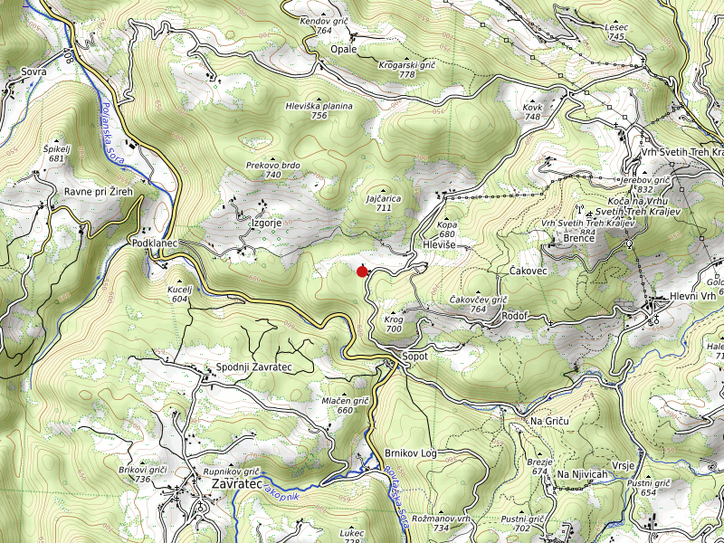
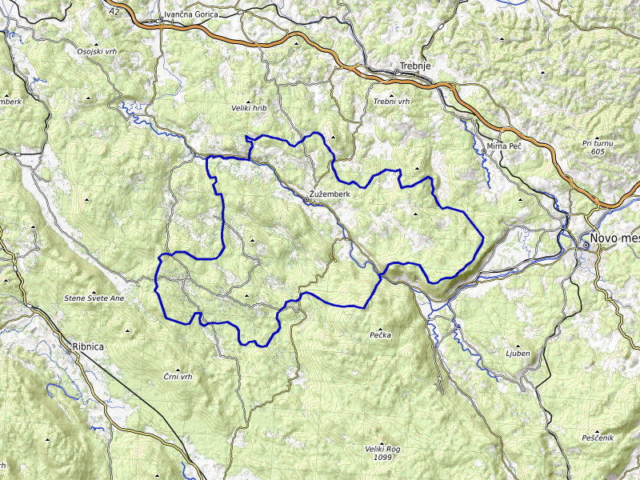

# SPIN112 Incident Reporting Telegram Bot

__[Sample:](https://t.me/nasoncnistranialp)__

## Introduction

This **Telegram bot** is designed to automatically fetch and post incidents from the [SPIN3](https://spin3.sos112.si) RSS system to a designated Telegram supergroup and its topics. The incidents include various emergency situations such as traffic accidents, technical assistance, fire, explosions, and more, when they are reported 🟨 or when checked 🟩.

⚠️ **Disclaimer**: This software is **not affiliated** with or endorsed by the *Uprava Republike Slovenije za zaščito in reševanje* (_en. Administration for Civil Protection and Disaster Relief_). The bot was developed by a **Telegram enthusiast** and is maintained at the author's own cost. Contributions of any kind (feedback, code contributions, donations, etc.) are welcome and greatly appreciated! 

## Features

- Automatically fetches incidents from SPIN3 every 180 sec and posts them to a Telegram supergroup SPIN.
- Supports categorization of incidents by region and intervention type.
- Uses a custom `topics` dictionary to map various keywords in incidents to specific Telegram topics.
- Creates and posts static map images for incidents with GPS coordinates, including:
  - Point markers for individual incident locations as specified in the report.
  - Polygon boundaries for larger incidents (e.g., "Večji obseg" events) to show the manicipality of the major event.
- Posts only new incidents and keeps track of already posted incidents using JSON files.

## Followed locations in private chat

Besides posting to the group, the bot can send incidents to a private chat for the
areas that chat follows. Every message in this section arrives as a DM, and the
group / topic / keyword posting is unaffected.

| Command | What it does |
| --- | --- |
| `/track` | Add a place: type a village/town or municipality name, coordinates plus radius (`46.2397 14.3567 10`) or a geohash (`gh:u24q4b`). A geohash is a rectangle, so the bot watches exactly that cell and never asks for a radius. Otherwise it proposes a radius (`1`, `5`, `10`, `25`, `50` km or your own 1–100 km), asks for a name, then asks which incident kinds to follow. |
| `/list` | Show all followed locations on a map with their radius circles and municipality borders. Areas are drawn translucent, and every outline is drawn on top, so a lower area's border stays visible where a circle or another municipality covers it. |
| `/topics` | Change the incident kinds of an already saved location (`/topics 3` or pick it from the list). |
| `/remove` | Delete one followed location (with confirmation). |
| `/stop` | Delete every followed location and stop the DMs. |
| `/help` | Full instructions. |
| `/contact` | Contact the developer — the message has a button that opens a chat with them (questions, ideas, bug reports). |

**Talking to the developer without a command.** A user can just type at the bot in
private: any message that is not a command (and not part of a `/track` step) is
copied to the developer's chat with the sender's name, `@username` and numeric id
attached, and the user gets a short confirmation. Photos, voice notes, videos and
documents are forwarded as they are. The target chat is the `DEV_CHAT_ID`
environment variable, so the developer account can change without touching code;
leave it unset and the relay is off. Messages the developer sends to the bot
himself are never relayed.

**Incident kinds (topics).** After the location is chosen, the bot offers the kinds
it can filter on — `Epidemije`, `Jedrska ali radiološka nevarnost`,
`Športne aktivnosti`, `Požar, eksplozija`, `Prometna nesreča`, hazmat,
`Najdbe NUS`, `Gore` and the remaining intervention types. Toggle any number of
them and save; the selection is stored per location, so one location can follow
only epidemics while another follows everything. Selecting **nothing** means
"all incidents in the area", which is the previous behaviour. A kind comes from
the incident's intervention type *or* its keyword match, exactly like the group
topics — so choosing `Športne aktivnosti` or `Gore` also catches incidents whose
title mentions sports or mountain activity. Incidents whose kind cannot be
determined are not filtered out.

`1 km` is the super-local option: it follows a single street or hamlet, and the
circle on the map stays inside the surrounding town.

Max 15 locations per chat. The database lives in `subscriptions.db`
(override with the `SUBSCRIPTIONS_DB` environment variable).

## Lost topics repair themselves

Posts go to fixed topic ids (`message_thread_id`). If a topic is deleted in
Telegram, the API answers *message thread not found* and every post for that
topic would be dropped. Instead the bot recreates the topic under the same name
and remembers the new id in `topic_ids.json`, so posting resumes on the next
incident and survives a restart. Before creating anything it probes the topic
with `editForumTopic`, so an existing topic is never duplicated. This needs the
bot's **Manage topics** admin right in the group; without it the error is
logged and the post is skipped. At startup the bot logs whether it holds that
right.

## Installation

### 1. Clone the repository:

```git clone https://github.com/StellarStoic/SPIN112```

```cd SPIN112```

2. Install the required dependencies:
```pip install -r requirements.txt```
3. Create a .env file:
In the root directory, create a ```.env``` file with the following content:

TELEGRAM_BOT_TOKEN=your_telegram_bot_token
TELEGRAM_GROUP_ID=your_telegram_group_id

__Replace your_telegram_bot_token with your bot token from BotFather and your_telegram_group_id with your Telegram supergroup ID.__

4. Run the bot:
```python SPIN112bot.py```

### Files
```SPIN112bot.py```: Main script to run the bot.
```posted_incidents.json```: Stores IDs of posted incidents to prevent reposting.
```posted_vecjiObseg.json```: Stores posted "Večji obseg" incidents (these events have no ID). An alert is posted once and is only posted again when its **core** changes: municipality, event time, and the body text with the constantly rewritten clock window ("… smo do 17:35 …") masked out. A running alert that only moves its window forward no longer repeats every 5 minutes.
```.env```: Environment variables (bot token and group ID).

Example Output
Incident Location Map:



Polygon Map of Incident:



Contributing
This project is maintained at my own cost, and I welcome contributions of any kind. If you have any suggestions, issues, or improvements, feel free to open a pull request or an issue on GitHub.

If you'd like to support the project, reach out to me on Telegram or consider contributing code, documentation, or even a small donation to help with hosting costs.

License
This project is licensed under the MIT License. See the LICENSE file for more details.